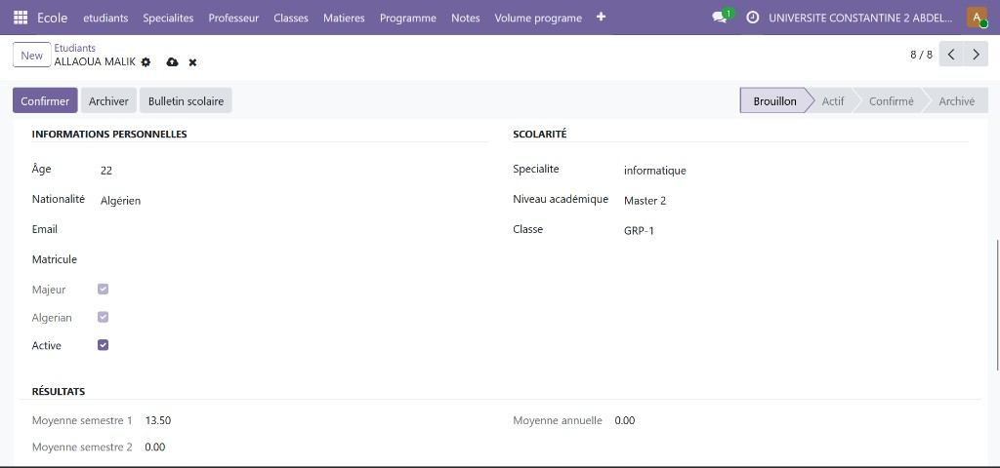
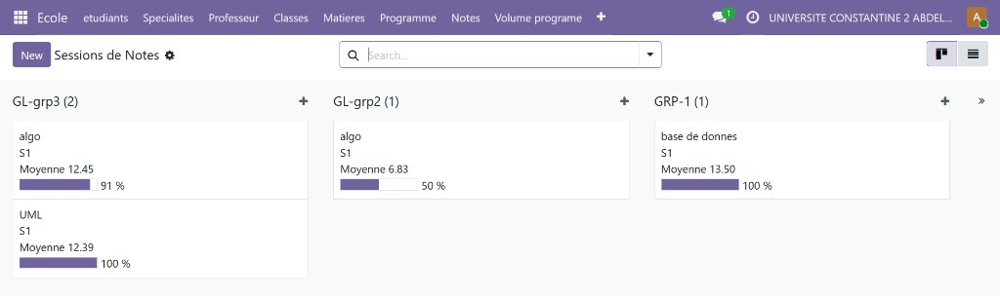
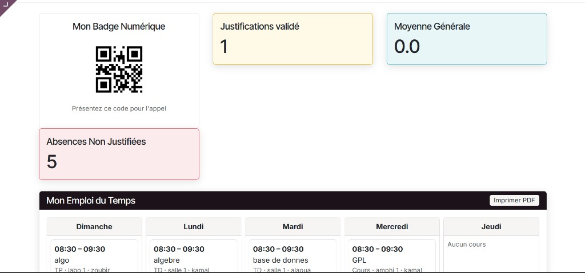
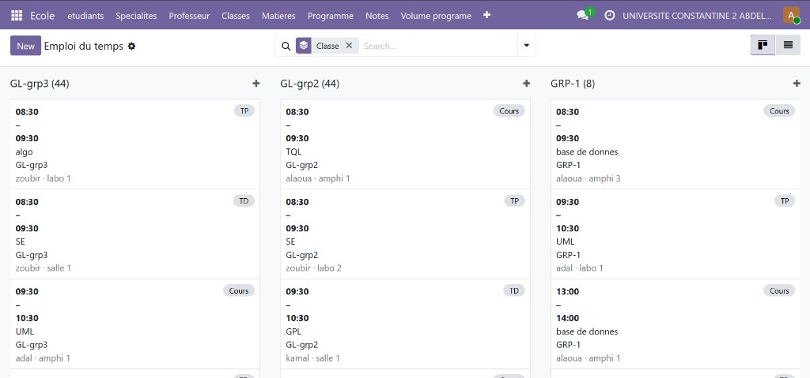

# School

Module Odoo 19 de gestion scolaire : étudiants, classes, professeurs, programmes, notes, absences, emplois du temps et portail.

Le dossier `school` est un addon autonome. Il se copie dans le chemin des addons, il ne contient pas le serveur Odoo.

## Fonctionnalités

### Étudiants

- Fiche : nom, photo, âge, e-mail, matricule, nationalité (Algérie, Maroc, France, Tunisie).
- Scolarité : spécialité, niveau (Licence 1 à 3, Master 1 et 2, doctorat) et classe.
- Statuts : brouillon, confirmé, actif, archivé. Chaque changement est suivi dans le chatter et dans un historique.
- QR code généré pour l’étudiant, utilisé comme badge.
- Majeur calculé à partir de l’âge, et indicateur « algérien » calculé à partir de la nationalité.
- Moyennes de semestre et moyenne annuelle, calculées depuis les notes.

### Spécialités, classes et salles

- Une spécialité regroupe ses étudiants et ses matières, avec un compteur d’étudiants.
- Une classe a un niveau, une capacité, des étudiants, des matières et un programme. Elle peut être ouverte, complète ou clôturée.
- Les salles sont un amphithéâtre, une salle ou un laboratoire.

### Professeurs et affectations

- Fiche professeur : nom, téléphone, e-mail, compte Odoo, spécialité et matières.
- Une affectation relie un professeur, une matière, une classe et un semestre. Le même triplet ne peut pas être saisi deux fois.

### Matières et programme

- Une matière a un code, un coefficient, un semestre, un professeur et des volumes horaires (cours, TD, TP).
- Un programme couvre un semestre et une ou plusieurs classes.
- Le volume du programme liste, pour chaque matière, les heures de cours, de TD et de TP.
- Depuis le programme, on génère l’emploi du temps, ou on le supprime pour le refaire.

### Notes

La moyenne d’une matière est :

`(((TD + TP) / 2) + contrôle × 2) / 3`

La somme de la matière est cette moyenne multipliée par le coefficient. La moyenne du semestre est la somme des notes pondérées divisée par la somme des coefficients. La moyenne annuelle est la moyenne des deux semestres, uniquement quand les deux existent.

- Saisie note par note, ou par session de classe : on charge les étudiants de la classe, puis on saisit TD, TP et contrôle.
- La liste des matières proposées vient du programme de la classe et du semestre.
- Les notes sont refusées si elles sont négatives ou au-dessus de 20.
- Vues kanban, liste et formulaire. Filtre « sous 10 ». Une session affiche la moyenne de la classe et le taux de réussite.
- Bulletin scolaire en PDF depuis la fiche étudiant.

### Absences

- Absence liée à un étudiant, une matière et une date.
- L’étudiant dépose un justificatif PDF. Le secrétariat valide ou refuse.
- Au-delà de 5 absences non justifiées dans la même matière, l’étudiant est archivé et un e-mail d’alerte part s’il a une adresse.
- Chaque absence en dessous de ce seuil envoie aussi un avertissement par e-mail.
- Appel en ligne : le professeur ouvre le cours du jour et coche les présents. Les absents reçoivent une absence.
- Ticket PDF d’absence.

### Emploi du temps

- Créneaux du dimanche au jeudi, avec heure de début, heure de fin, type (cours, TD, TP), classe, matière, professeur et salle.
- Vues kanban par jour ou par classe, liste et formulaire.
- Le portail étudiant affiche la semaine en cinq colonnes.
- PDF de l’emploi du temps depuis le programme.

### Portail étudiant

Le compte Odoo de l’étudiant doit être renseigné sur sa fiche, et le compte doit être dans le groupe **École : Étudiant**.

- Tableau de bord : badge QR, justificatifs validés, moyenne générale, absences non justifiées, emploi du temps.
- Bulletin, liste des absences, dépôt d’un justificatif.
- Réclamations : administratif, technique ou pédagogique. Un ticket pédagogique est envoyé au professeur de la matière. Un ticket administratif ou technique est envoyé au premier administrateur école qui a un e-mail.
- Téléchargement du badge PDF.

### Portail professeur

Le professeur doit avoir un compte Odoo lié, dans le groupe **École : Enseignant**.

- Tableau de bord du jour.
- Feuille d’appel du créneau, puis création des absences.

### Droits

| Groupe | Rôle |
| --- | --- |
| École : Étudiant | Lit ses propres données |
| École : Enseignant | Inclut l’étudiant, saisit notes et absences de son périmètre |
| École : Administrateur | Inclut l’enseignant, voit et modifie tout le module |
| Administration Odoo (Settings) | Reçoit automatiquement le groupe administrateur école |

Un étudiant ne voit que sa fiche, ses notes, ses absences, ses tickets, sa classe et son programme. L’administrateur école a une règle qui voit tous ces enregistrements.

Les routes `/api/students` et `/api/create_student` exigent une session et le groupe administrateur école. Elles ne sont pas publiques.

### PDF

- Bulletin scolaire
- Emploi du temps du programme
- Ticket d’absence
- Badge étudiant

## Captures









## Installation

1. Copier ce dossier dans le chemin des addons, par exemple `odoo/custom_addons/school`.
2. Installer la librairie du QR code dans l’environnement Python d’Odoo : `pip install qrcode`
3. Démarrer Odoo avec ce chemin dans `addons_path`.
4. Activer le mode développeur, mettre à jour la liste des applications, puis installer **School**.

Dépendances Odoo : `base`, `mail`, `website`, `portal`.

```bash
odoo-bin -c odoo.conf -d NOM_BASE -i school
```

Après une mise à jour du code :

```bash
odoo-bin -c odoo.conf -d NOM_BASE -u school --stop-after-init
```

## Technique

- Version du module : `19.0.1.0.0`
- Licence : LGPL-3
- Modèles principaux : `school.student`, `school.teacher`, `school.classes`, `school.matiere`, `school.program`, `school.program_volume`, `school.grade`, `school.grade_session`, `school.absence`, `school.timetable`, `school.ticket`, `school.room`, `school.affectation`

---

## English

Odoo 19 school addon: students, classes, teachers, programs, grades, absences, timetables, and a portal.

The `school` folder is a standalone addon. Copy it into the addons path. It does not include the Odoo server.

### Features

#### Students

- Record: name, photo, age, email, registration number, nationality (Algeria, Morocco, France, Tunisia).
- Studies: speciality, level (Bachelor years 1–3, Master years 1–2, doctorate), and class.
- States: draft, confirmed, active, archived. Each change is tracked on the chatter and in a history log.
- A QR code is generated and used as the student badge.
- Adult flag from age, and an Algerian flag from nationality.
- Semester averages and a yearly average, computed from grades.

#### Specialities, classes, and rooms

- A speciality groups its students and subjects, with a student count.
- A class has a level, a capacity, students, subjects, and a program. It can be open, full, or closed.
- Rooms are a lecture hall, a classroom, or a lab.

#### Teachers and assignments

- Teacher record: name, phone, email, Odoo user, speciality, and subjects.
- An assignment links one teacher, one subject, one class, and one semester. The same combination cannot be stored twice.

#### Subjects and program

- A subject has a code, a coefficient, a semester, a teacher, and hour volumes (lecture, tutorial, lab).
- A program covers one semester and one or more classes.
- The program volume lists lecture, tutorial, and lab hours for each subject.
- From the program, the timetable can be generated or wiped and rebuilt.

#### Grades

A subject average is:

`(((tutorial + lab) / 2) + exam × 2) / 3`

The weighted subject total is that average times the coefficient. The semester average is the sum of weighted totals divided by the sum of coefficients. The yearly average is the mean of both semesters, and only when both exist.

- Enter grades one by one, or by class session: load the class, then enter tutorial, lab, and exam marks.
- The subject list comes from the class program and the semester.
- Marks below 0 or above 20 are rejected.
- Kanban, list, and form views. Filter for averages under 10. A session shows the class average and the pass rate.
- PDF report card from the student form.

#### Absences

- An absence is tied to a student, a subject, and a date.
- The student uploads a PDF justification. Staff accept or refuse it.
- After more than 5 unjustified absences in the same subject, the student is archived and an alert email is sent when an address exists.
- Each absence below that threshold also sends a warning email.
- Online roll call: the teacher opens today’s session and marks who is present. Missing students get an absence.
- PDF absence slip.

#### Timetable

- Slots from Sunday to Thursday, with start, end, type (lecture, tutorial, lab), class, subject, teacher, and room.
- Kanban by day or by class, plus list and form.
- The student portal shows the week in five columns.
- PDF timetable from the program.

#### Student portal

The student’s Odoo user must be set on the student record, and that user must be in the **School: Student** group.

- Dashboard: QR badge, accepted justifications, overall average, unjustified absences, timetable.
- Report card, absence list, justification upload.
- Requests: administrative, technical, or teaching. A teaching ticket goes to the subject teacher. An administrative or technical ticket goes to the first school administrator who has an email.
- PDF badge download.

#### Teacher portal

The teacher needs a linked Odoo user in the **School: Teacher** group.

- Today’s dashboard.
- Roll-call sheet for the slot, then absence creation.

#### Access

| Group | Role |
| --- | --- |
| School: Student | Reads only their own data |
| School: Teacher | Includes the student group, enters grades and absences in their scope |
| School: Administrator | Includes the teacher group, reads and writes the whole addon |
| Odoo Settings | Automatically receives the school administrator group |

A student only sees their own record, grades, absences, tickets, class, and program. The school administrator has a rule that sees all of those records.

`/api/students` and `/api/create_student` require a logged-in session and the school administrator group. They are not public.

#### PDF reports

- Report card
- Program timetable
- Absence slip
- Student badge

### Screenshots


### Installation

1. Copy this folder into the addons path, for example `odoo/custom_addons/school`.
2. Install the QR library in Odoo’s Python environment: `pip install qrcode`
3. Start Odoo with that path in `addons_path`.
4. Enable developer mode, update the apps list, then install **School**.

Odoo dependencies: `base`, `mail`, `website`, `portal`.

```bash
odoo-bin -c odoo.conf -d DATABASE -i school
```

After a code update:

```bash
odoo-bin -c odoo.conf -d DATABASE -u school --stop-after-init
```

### Technical

- Module version: `19.0.1.0.0`
- License: LGPL-3
- Main models: `school.student`, `school.teacher`, `school.classes`, `school.matiere`, `school.program`, `school.program_volume`, `school.grade`, `school.grade_session`, `school.absence`, `school.timetable`, `school.ticket`, `school.room`, `school.affectation`

---

## Deutsch

Odoo-19-Modul für die Schulverwaltung: Studierende, Klassen, Lehrkräfte, Programme, Noten, Abwesenheiten, Stundenpläne und ein Portal.

Der Ordner `school` ist ein eigenständiges Addon. Er wird in den Addons-Pfad kopiert und enthält nicht den Odoo-Server.

### Funktionen

#### Studierende

- Karte: Name, Foto, Alter, E-Mail, Matrikelnummer, Nationalität (Algerien, Marokko, Frankreich, Tunesien).
- Studium: Fachrichtung, Niveau (Licence 1–3, Master 1–2, Doktorat) und Klasse.
- Status: Entwurf, bestätigt, aktiv, archiviert. Jede Änderung steht im Chatter und in einem Verlauf.
- Ein QR-Code wird erzeugt und dient als Ausweis.
- Volljährigkeit aus dem Alter, Kennzeichen „algerisch“ aus der Nationalität.
- Semesterdurchschnitte und Jahresdurchschnitt aus den Noten.

#### Fachrichtungen, Klassen und Räume

- Eine Fachrichtung bündelt Studierende und Fächer, mit einer Anzahl.
- Eine Klasse hat Niveau, Kapazität, Studierende, Fächer und ein Programm. Sie kann offen, voll oder geschlossen sein.
- Räume sind Hörsaal, Seminarraum oder Labor.

#### Lehrkräfte und Zuweisungen

- Lehrkraft: Name, Telefon, E-Mail, Odoo-Benutzer, Fachrichtung und Fächer.
- Eine Zuweisung verbindet eine Lehrkraft, ein Fach, eine Klasse und ein Semester. Dieselbe Kombination kann nicht doppelt gespeichert werden.

#### Fächer und Programm

- Ein Fach hat Code, Koeffizient, Semester, Lehrkraft und Stundenvolumen (Vorlesung, Übung, Praktikum).
- Ein Programm gilt für ein Semester und eine oder mehrere Klassen.
- Das Programmvolumen listet Vorlesungs-, Übungs- und Praktikumsstunden je Fach.
- Aus dem Programm wird der Stundenplan erzeugt oder gelöscht und neu aufgebaut.

#### Noten

Der Fachdurchschnitt ist:

`(((Übung + Praktikum) / 2) + Prüfung × 2) / 3`

Die gewichtete Fachsumme ist dieser Durchschnitt mal Koeffizient. Der Semesterdurchschnitt ist die Summe der gewichteten Werte geteilt durch die Summe der Koeffizienten. Der Jahresdurchschnitt ist der Mittelwert beider Semester, und nur wenn beide vorhanden sind.

- Noten einzeln erfassen oder in einer Klassensitzung: Klasse laden, dann Übung, Praktikum und Prüfung eintragen.
- Die Fächerliste kommt aus dem Programm der Klasse und dem Semester.
- Noten unter 0 oder über 20 werden abgelehnt.
- Kanban-, Listen- und Formularansicht. Filter für Durchschnitte unter 10. Eine Sitzung zeigt den Klassendurchschnitt und die Bestehensquote.
- PDF-Zeugnis aus der Studierendenkarte.

#### Abwesenheiten

- Eine Abwesenheit hängt an Studierendem, Fach und Datum.
- Der Studierende lädt eine PDF-Bescheinigung hoch. Das Sekretariat nimmt sie an oder lehnt sie ab.
- Nach mehr als 5 unentschuldigten Abwesenheiten im selben Fach wird der Studierende archiviert. Liegt eine Adresse vor, geht eine Warnmail hinaus.
- Jede Abwesenheit unter dieser Schwelle sendet ebenfalls eine Hinweismail.
- Online-Anwesenheitskontrolle: die Lehrkraft öffnet die heutige Stunde und markiert die Anwesenden. Fehlende erhalten eine Abwesenheit.
- PDF-Abwesenheitsbeleg.

#### Stundenplan

- Termine von Sonntag bis Donnerstag, mit Beginn, Ende, Art (Vorlesung, Übung, Praktikum), Klasse, Fach, Lehrkraft und Raum.
- Kanban nach Tag oder Klasse, dazu Liste und Formular.
- Das Studierendenportal zeigt die Woche in fünf Spalten.
- PDF-Stundenplan aus dem Programm.

#### Studierendenportal

Der Odoo-Benutzer muss auf der Karte stehen und in der Gruppe **Schule: Studierende** sein.

- Übersicht: QR-Ausweis, angenommene Bescheinigungen, Gesamtdurchschnitt, unentschuldigte Abwesenheiten, Stundenplan.
- Zeugnis, Abwesenheitsliste, Upload einer Bescheinigung.
- Anfragen: Verwaltung, Technik oder Lehre. Eine Lehranfrage geht an die Lehrkraft des Fachs. Eine Verwaltungs- oder Technikfrage geht an die erste Schuladministration mit E-Mail.
- PDF-Ausweis herunterladen.

#### Lehrkraftportal

Die Lehrkraft braucht einen verknüpften Odoo-Benutzer in der Gruppe **Schule: Lehrkraft**.

- Tagesübersicht.
- Anwesenheitsliste der Stunde, danach werden Abwesenheiten angelegt.

#### Rechte

| Gruppe | Rolle |
| --- | --- |
| Schule: Studierende | Sieht nur die eigenen Daten |
| Schule: Lehrkraft | Enthält die Studierendengruppe, erfasst Noten und Abwesenheiten im eigenen Bereich |
| Schule: Administration | Enthält die Lehrkraftgruppe, liest und schreibt das ganze Modul |
| Odoo-Einstellungen | Erhält automatisch die Schuladministration |

Ein Studierender sieht nur die eigene Karte, Noten, Abwesenheiten, Tickets, Klasse und Programm. Die Schuladministration hat eine Regel, die alle diese Datensätze sieht.

`/api/students` und `/api/create_student` verlangen eine Anmeldung und die Gruppe Schuladministration. Sie sind nicht öffentlich.

#### PDF

- Zeugnis
- Programm-Stundenplan
- Abwesenheitsbeleg
- Studierendenausweis

### Bilder


### Installation

1. Diesen Ordner in den Addons-Pfad kopieren, zum Beispiel `odoo/custom_addons/school`.
2. Die QR-Bibliothek in der Python-Umgebung von Odoo installieren: `pip install qrcode`
3. Odoo mit diesem Pfad in `addons_path` starten.
4. Entwicklermodus einschalten, die Anwendungsliste aktualisieren, dann **School** installieren.

Odoo-Abhängigkeiten: `base`, `mail`, `website`, `portal`.

```bash
odoo-bin -c odoo.conf -d DATENBANK -i school
```

Nach einer Codeänderung:

```bash
odoo-bin -c odoo.conf -d DATENBANK -u school --stop-after-init
```

### Technik

- Modulversion: `19.0.1.0.0`
- Lizenz: LGPL-3
- Hauptmodelle: `school.student`, `school.teacher`, `school.classes`, `school.matiere`, `school.program`, `school.program_volume`, `school.grade`, `school.grade_session`, `school.absence`, `school.timetable`, `school.ticket`, `school.room`, `school.affectation`

---

<div dir="rtl">

## العربية

تطبيق أودو 19 لإدارة المدرسة: الطلبة، والأفواج، والأساتذة، والبرامج، والعلامات، والغيابات، وجداول التوقيت، وبوابة.

مجلد `school` إضافة مستقلة. يُنسخ إلى مسار الإضافات، ولا يتضمّن خادم أودو.

### الوظائف

#### الطلبة

- البطاقة: الاسم، والصورة، والسن، والبريد، ورقم التسجيل، والجنسية (الجزائر، المغرب، فرنسا، تونس).
- الدراسة: التخصص، والمستوى (ليسانس 1 إلى 3، ماستر 1 و2، دكتوراه)، والفوج.
- الحالات: مسودة، مؤكَّد، نشط، مؤرشف. كل تغيير يُسجَّل في المحادثة وفي سجل تاريخي.
- يُنشأ رمز QR ويُستعمل كشارة الطالب.
- راشد حسب السن، وعلامة «جزائري» حسب الجنسية.
- معدلات الفصلين والمعدل السنوي، محسوبة من العلامات.

#### التخصصات والأفواج والقاعات

- التخصص يجمع طلبته ومواده، مع عدّاد للطلبة.
- الفوج له مستوى وطاقة استيعاب وطلبة ومواد وبرنامج. يمكن فتحه أو اعتباره ممتلئاً أو إغلاقه.
- القاعات: مدرج، أو قاعة، أو مخبر.

#### الأساتذة والتعيينات

- بطاقة الأستاذ: الاسم، والهاتف، والبريد، وحساب أودو، والتخصص، والمواد.
- التعيين يربط أستاذاً ومادة وفوجاً وسمستراً. لا يمكن تسجيل التركيبة نفسها مرتين.

#### المواد والبرنامج

- المادة لها رمز، ومعامل، وسمستر، وأستاذ، وحجم ساعي (درس، أعمال موجهة، أعمال تطبيقية).
- البرنامج يغطي سمستراً وفوجاً واحداً أو أكثر.
- حجم البرنامج يعرض ساعات الدرس والأعمال الموجهة والأعمال التطبيقية لكل مادة.
- من البرنامج يُولَّد جدول التوقيت، أو يُحذف ثم يُعاد بناؤه.

#### العلامات

معدل المادة هو:

`(((الأعمال الموجهة + الأعمال التطبيقية) / 2) + الامتحان × 2) / 3`

مجموع المادة هو هذا المعدل مضروباً في المعامل. معدل السمستر هو مجموع القيم المرجَّحة مقسوماً على مجموع المعاملات. المعدل السنوي هو متوسط السمسترين، وفقط عندما يوجد الاثنان.

- إدخال العلامات واحدة واحدة، أو عبر حصة الفوج: تحميل طلبة الفوج ثم إدخال الأعمال الموجهة والتطبيقية والامتحان.
- قائمة المواد تأتي من برنامج الفوج والسمستر.
- تُرفض العلامة إذا كانت أقل من 0 أو أكبر من 20.
- عروض كانبان وقائمة ونموذج. مرشح «أقل من 10». الحصة تعرض معدل الفوج ونسبة النجاح.
- كشف النقاط PDF من بطاقة الطالب.

#### الغيابات

- الغياب مرتبط بطالب ومادة وتاريخ.
- الطالب يرفع مبرراً بصيغة PDF. الإدارة تقبله أو ترفضه.
- بعد أكثر من 5 غيابات غير مبررة في المادة نفسها، يُؤرشف الطالب وتُرسل رسالة تنبيه إذا وُجد بريد.
- كل غياب تحت هذا الحد يرسل أيضاً رسالة تحذير.
- نداء الحضور: يفتح الأستاذ حصة اليوم ويحدد الحاضرين. الغائبون تُنشأ لهم غياب.
- وصل غياب PDF.

#### جدول التوقيت

- حصص من الأحد إلى الخميس، مع البداية والنهاية والنوع (درس، أعمال موجهة، أعمال تطبيقية) والفوج والمادة والأستاذ والقاعة.
- كانبان حسب اليوم أو الفوج، مع قائمة ونموذج.
- بوابة الطالب تعرض الأسبوع في خمسة أعمدة.
- PDF لجدول التوقيت من البرنامج.

#### بوابة الطالب

يجب ربط حساب أودو ببطاقة الطالب، وأن يكون الحساب في مجموعة **المدرسة: طالب**.

- لوحة: شارة QR، والمبررات المقبولة، والمعدل العام، والغيابات غير المبررة، وجدول التوقيت.
- كشف النقاط، وقائمة الغيابات، ورفع مبرر.
- الطلبات: إداري، أو تقني، أو بيداغوجي. الطلب البيداغوجي يذهب إلى أستاذ المادة. الطلب الإداري أو التقني يذهب إلى أول مدير مدرسة له بريد.
- تنزيل الشارة PDF.

#### بوابة الأستاذ

يحتاج الأستاذ إلى حساب أودو مرتبط في مجموعة **المدرسة: أستاذ**.

- لوحة اليوم.
- ورقة النداء للحصة، ثم إنشاء الغيابات.

#### الصلاحيات

| المجموعة | الدور |
| --- | --- |
| المدرسة: طالب | يقرأ بياناته فقط |
| المدرسة: أستاذ | تتضمّن مجموعة الطالب، ويدخل العلامات والغيابات في نطاقه |
| المدرسة: مدير | تتضمّن مجموعة الأستاذ، ويرى كل الوحدة ويعدّلها |
| إعدادات أودو | تحصل تلقائياً على مجموعة مدير المدرسة |

الطالب يرى بطاقته وعلاماته وغيابه وتذاكره وفوجه وبرنامجه فقط. مدير المدرسة له قاعدة ترى كل هذه السجلات.

المساران `/api/students` و`/api/create_student` يطلبان جلسة ومجموعة مدير المدرسة. ليسا عامين.

#### PDF

- كشف النقاط
- جدول توقيت البرنامج
- وصل الغياب
- شارة الطالب

### الصور


### التثبيت

1. انسخ هذا المجلد إلى مسار الإضافات، مثلاً `odoo/custom_addons/school`.
2. ثبّت مكتبة رمز QR في بيئة بايثون الخاصة بأودو: `pip install qrcode`
3. شغّل أودو مع هذا المسار في `addons_path`.
4. فعّل وضع المطوّر، حدّث قائمة التطبيقات، ثم ثبّت **School**.

اعتمادات أودو: `base` و`mail` و`website` و`portal`.

```bash
odoo-bin -c odoo.conf -d DATABASE -i school
```

بعد تعديل في الكود:

```bash
odoo-bin -c odoo.conf -d DATABASE -u school --stop-after-init
```

### تقني

- إصدار الوحدة: `19.0.1.0.0`
- الرخصة: LGPL-3
- النماذج الرئيسة: `school.student`, `school.teacher`, `school.classes`, `school.matiere`, `school.program`, `school.program_volume`, `school.grade`, `school.grade_session`, `school.absence`, `school.timetable`, `school.ticket`, `school.room`, `school.affectation`

</div>
